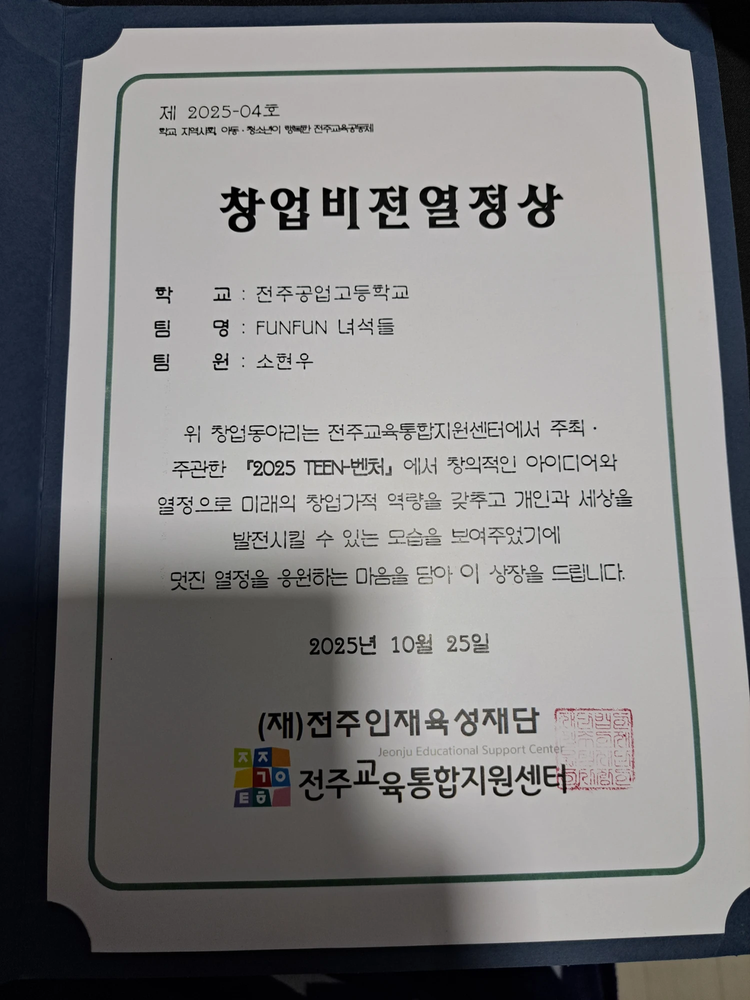
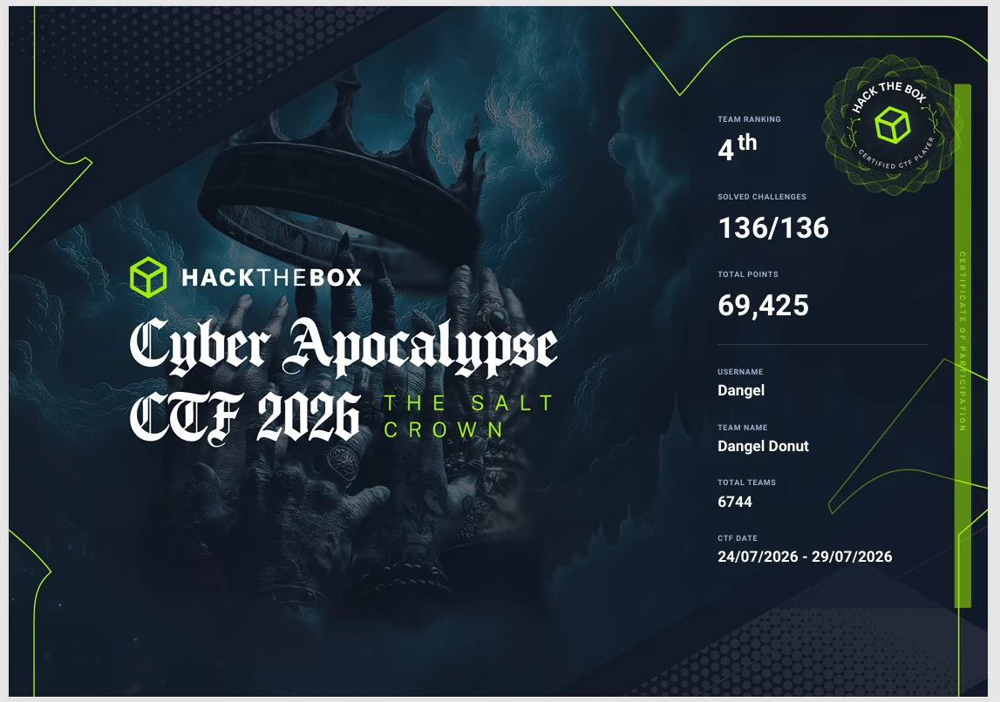
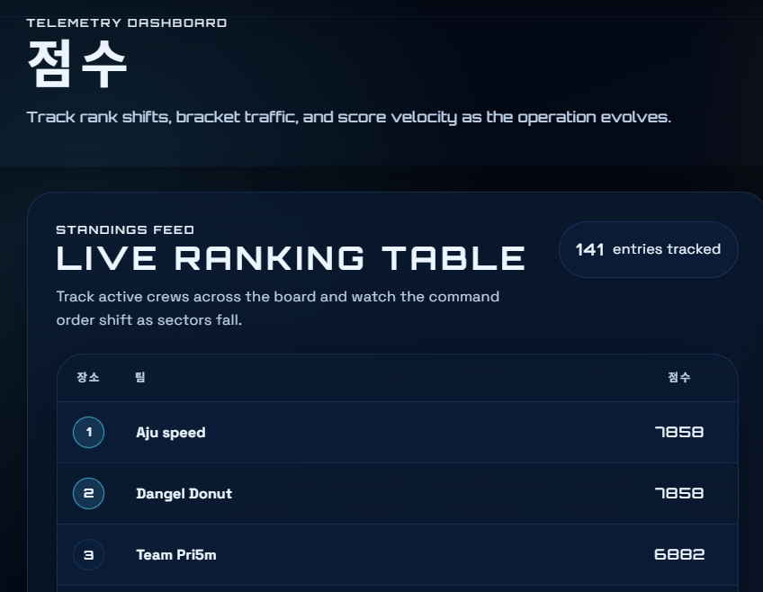
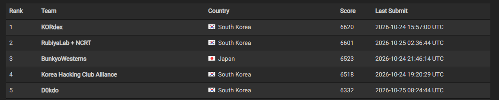

## 들어가며

블로그를 새로 열면서, 지금까지 무엇을 해왔는지 한 번 정리해보려고 한다.

## 보안 시작 계기

보안을 처음 시작한 건 초등학교 5학년 때였다.

그때 영재원에 다니면서 처음 코딩을 배웠는데, 코딩이 너무 재밌어서 막연하게 "나는 개발자가 되어야겠다"고 생각했다. 그러다 어느 날 **워너크라이(WannaCry)** 랜섬웨어 뉴스를 보게 됐다. 뉴스를 보고 머릿속에 가득했던 생각은 하나였다.

> "파일을 대체 어떻게 암호화하는 거지?"

이 질문을 계기로 악성코드와 암호학에 관심이 생겼고, 자연스럽게 악성코드 분석 공부를 시작하게 됐다.

처음엔 정말 어려웠다. 악성코드를 이해하려면 난독화 기법은 물론이고, 공격자가 어떤 발상으로 코드를 짰는지, 그리고 그 코드가 쓰인 언어에 대해서도 깊이 이해하고 있어야 했다.

아직도 기억나는 게 **GandCrab**이다. GandCrab은 **API 해싱**으로 어떤 Windows API를 호출하는지 숨겨두었는데, 당시에는 API 해싱이 뭔지도, 패커(Packer)가 뭔지도 몰라서 한참을 쩔쩔맸다.

지금처럼 GPT에게 "이 개념이 뭐야?"라고 물어보면 바로 알려주는 시대가 아니었기 때문에, 레딧(Reddit)이나 네이버 블로그를 하나하나 찾아보며 공부했던 기억이 난다.

## 개발

개발은 틈틈이 해왔다. C언어로 악성 문자열을 탐지하는 간단한 백신을 만들어보기도 했고, 직접 악성코드를 만든 뒤 스스로 뜯어보면서 분석 능력을 키우기도 했다.

그러다 고등학교에 와서 동아리 소속으로 **대한민국 사회적경제 박람회 in 전주**에 참가하게 됐다. 전국의 사회적기업, 협동조합, 마을기업, 자활기업 같은 사회적경제 조직들이 모여 제품과 서비스를 알리고 가치를 나누는 전국 단위의 대규모 행사다.

팀별로 주제를 정해 출품했는데, 우리 팀의 주제는 **자율주행 잔디깎이**였다. 나는 팀에서 코딩 파트를 맡아 경로 설정과 장애물 회피 소프트웨어를 담당했다. 이때 라즈베리파이를 처음 제대로 만져보면서 개발에도 재미를 붙이게 됐고, 그 결과 **2025 TEEN-벤처**에서 **창업비전열정상(2등)**을 받았다.

이 행사는 기사로도 소개됐다.

- [이로운넷 - 제7회 대한민국 사회적경제 박람회 in 전주, 시민과 함께한 상생의 축제 성료](https://www.eroun.net/news/articleView.html?idxno=65595)

## CTF / Wargame

### 드림핵을 알게 되기까지

**드림핵(Dreamhack)**은 2025년 말에 알게 됐다. 그전까지는 주변에 해킹하는 사람이 한 명도 없어서, 늘 혼자 작업하고 혼자 연구했기 때문이다.

### RubiyaLab, 그리고 CTF의 시작

CTF를 시작하게 된 건 악성코드 분석 디스코드에서 활동하던 때였다. 거기서 알게 된 동생이 어느 날 이렇게 물어봤다.

> "RubiyaLab 들어오실래요?"

그 동생의 추천을 받아 **RubiyaLab**에 들어오면서 본격적으로 CTF 활동을 시작했다.

나는 지금도 그 동생을 은인이라고 생각하며 살고 있다. 내 인생의 전환점이었고, 보안을 좁게만 보던 나에게 훨씬 넓은 세상을 보여준 사람이기 때문이다.

### 주요 기록

그 동생, 그리고 그 동생 친구들과 함께 **Dangel Donut** 팀으로 여러 CTF에 나갔다.

#### HackTheBox Cyber Apocalypse CTF 2026: The Salt Crown 4위

- 기간: 2026.07.24 ~ 2026.07.29
- 결과: 전체 **6,744팀 중 4위**
- 136문제 전부 해결 (136/136), 총 69,425점

#### Universal CTF 2위

- 결과: **2위** (1위 팀과 같은 7,858점)

#### HITCON CTF 2026 2위 (RubiyaLab + NCRT 연합)

이번에는 **RubiyaLab + NCRT(네이버클라우드)** 연합 팀으로 **HITCON CTF 2026**에 나가 **2위**를 했다. 이 대회에서 나는 **리버싱**을 했었는데, 팀에 리버싱 고수가 많아서 다 같이 달려들어 빠르게 풀어냈던 기억이 난다.

## 부족했던 점과 앞으로의 계획

지금까지의 활동을 돌아보면 CTF나 개발 쪽 경험은 꽤 쌓였지만, **자격증**과 **공모전** 경험은 아직 부족하다.

이 부분은 앞으로 이렇게 채워나가려고 한다.

- **자격증**: 2~3학년 때 **네트워크관리사**나 **정보보안산업기사** 취득에 도전해볼 생각이다.
- **공모전**: 정보보안 관련 공모전에 최대한 많이 나가볼 것이다.
